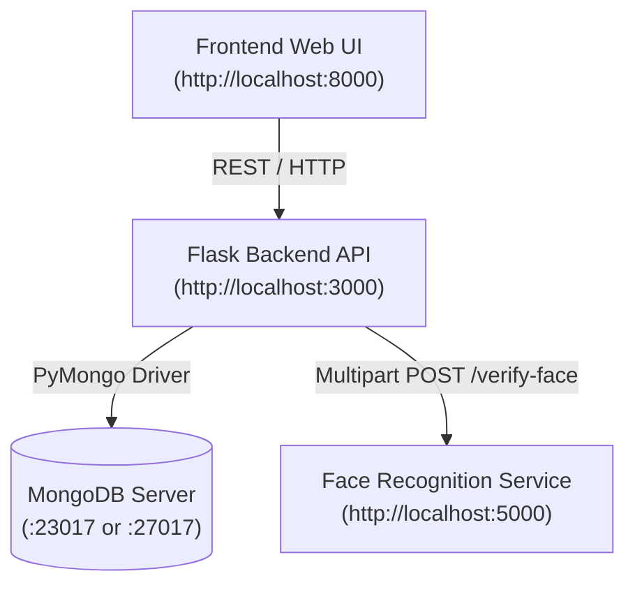

# Smart Security System — Local HTTP REST Edition

A microservices-based smart door security system with biometric facial recognition and PIN verification, built using **Python (Flask)**, **DeepFace (Facenet + RetinaFace)**, **MongoDB**, and a **Vanilla HTML/JavaScript** frontend.

---

## 🏛 Architecture



| Service | Port | Description |
| :--- | :--- | :--- |
| **Frontend** | `8000` | Browser-based user interface for door selection, face capture, and PIN entry. |
| **Backend API** | `3000` | Central REST gateway managing business logic, door lookup, and database records. |
| **Face Recognition** | `5000` | Biometric microservice using DeepFace with the Facenet model & RetinaFace detector. |
| **MongoDB** | `23017` / `27017` | NoSQL database storing registered doors, hashed user PINs, and enrolled face vectors. |

---

## ⏱️ Important Note: Face Verification Latency

> [!IMPORTANT]
> **"Verify Face" takes time — this is normal and expected!**
> 
> - **Why it takes time**: The service runs a deep neural network pipeline:
>   1. **RetinaFace detector**: Scans both the uploaded image and stored database images to locate and align faces with landmark points.
>   2. **Facenet model**: Computes high-dimensional facial embeddings and calculates cosine similarity across all registered users for that door.
> - **First Run**: Can take **30 to 90 seconds** because TensorFlow initializes its computation graph and DeepFace automatically caches the pretrained model weights (`~200 MB`).
> - **Subsequent Runs**: Usually take **3 to 6 seconds** per verification.
> - **Tip**: When you click **Verify Face**, please wait patiently until the browser alert dialog appears. Do not refresh or close the page while verification is in progress.

---

## ⚙️ Prerequisites

1. **Python 3.10 or 3.11** installed.
2. **MongoDB Community Server** running locally:
   - On this machine, the local Windows MongoDB service is listening on port **`23017`** (the scripts automatically detect this).
3. **Virtual Environment** (Recommended):
   ```powershell
   python -m venv .venv
   .\.venv\Scripts\Activate.ps1
   ```

---

## 📦 Installation

Ensure your virtual environment is active, then install the dependencies:

```powershell
pip install -r requirements.txt
```

---

## 🚀 How to Run

### Method 1: One-Click Startup (Recommended)

Run the included PowerShell script from this folder:

```powershell
.\start_local.ps1
```

**What this script does automatically:**
1. Tests and detects your active MongoDB port (`23017` or `27017`).
2. Seeds the database with demo door, user, and face profiles.
3. Spawns 3 separate labeled PowerShell windows:
   - Window 1: **Face Recognition Service** (`:5000`)
   - Window 2: **Backend API** (`:3000`)
   - Window 3: **Frontend Web Server** (`:8000`)
4. Launches your default browser directly to `http://localhost:8000`.

To cleanly terminate all running services at any time:
```powershell
.\stop_local.ps1
```

---

### Method 2: Manual Step-by-Step Startup

If you prefer to start each service manually across separate terminal tabs:

#### 1. Seed Demo Database (Run once)
```powershell
cd Backend
python seed_data.py
```
*Expected output: `Demo data inserted: Door1 / user manish / PIN 1234`*

#### 2. Start Face Recognition Service (Terminal 1)
```powershell
cd Face_rec
python app.py
```
*Listens on `http://localhost:5000`.*

#### 3. Start Backend Flask API (Terminal 2)
```powershell
cd Backend
python app.py
```
*Listens on `http://localhost:3000`.*

#### 4. Start Frontend HTTP Server (Terminal 3)
From the `Local_SecSysHTTP` directory:
```powershell
python -m http.server 8000 --directory Frontend
```
*Open `http://localhost:8000` in your web browser.*

---

## 🧪 Demo Testing Walkthrough

Follow these steps in your browser:

1. **Step 1 — Door Selection**:
   - Enter Door Name: `Door1`
   - Click **Continue**.
2. **Step 2 — Face Upload**:
   - Click **Choose File** and select:
     `Backend\faces\bob1.jpeg` (or `bob2.jpeg`)
   - Click **Upload Face** $\to$ *Face uploaded successfully*.
3. **Step 3 — Verify Face**:
   - Click **Verify Face**.
   - *Wait a few seconds for DeepFace inference to complete.*
   - Alerts: *Face verified. User identified.*
   - Identified User displays: **`manish`**.
4. **Step 4 — Verify PIN**:
   - Enter PIN: `1234`
   - Click **Verify PIN** $\to$ *Access Granted ✅*.

---

## 📡 REST API Reference

| Endpoint | Method | Payload / Content | Description |
| :--- | :--- | :--- | :--- |
| `/health` | `GET` | None | Backend & MongoDB health check |
| `/ring-doorbell` | `POST` | `{"doorName": "Door1"}` | Validates door existence and returns MongoDB `doorId` |
| `/face-upload` | `POST` | Multipart form field `face` | Stores uploaded image bytes in `faces` collection; returns `face_id` |
| `/verifyFace` | `POST` | `{"doorName": "Door1", "face_id": "..."}` | Compares uploaded face against stored faces assigned to that door |
| `/verifyPin` | `POST` | `{"doorName": "Door1", "username": "manish", "plainPin": "1234"}` | Validates user's salted bcrypt PIN hash |

---

## 🛠️ Troubleshooting

- **"Face recognition service unavailable"**:
  Ensure the Face Recognition service (`Face_rec\app.py`) is running on port 5000 before clicking Verify Face. You can verify it by opening `http://localhost:5000/health` in your browser.
- **"Database unavailable"**:
  Make sure your local MongoDB service is running (`Get-Service MongoDB`). The configuration dynamically defaults to `mongodb://localhost:23017`.
- **Port already in use**:
  Run `.\stop_local.ps1` to clear any hung Python processes on ports 3000, 5000, or 8000.
