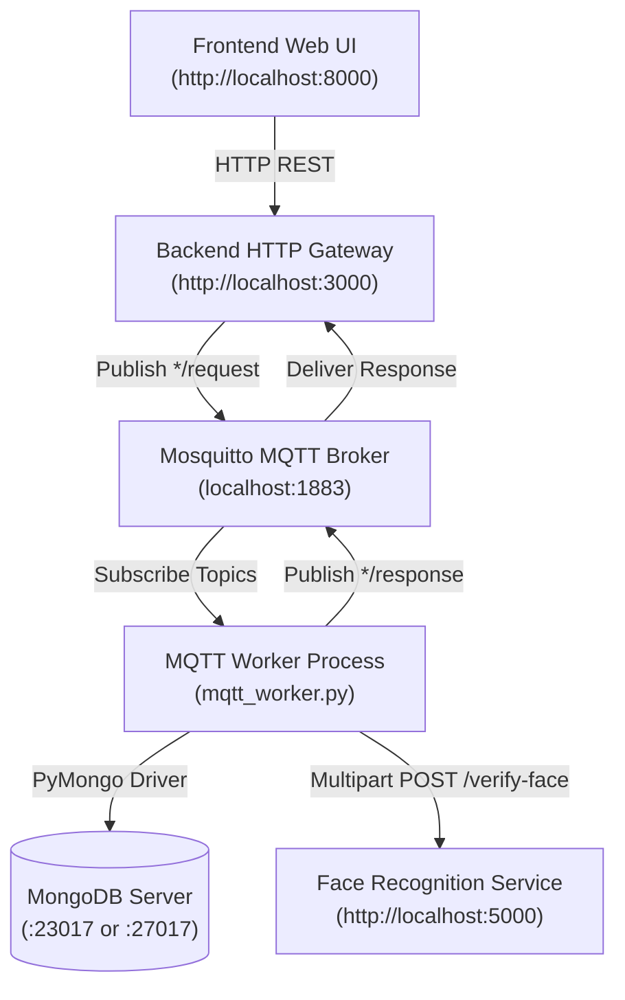

# Smart Security System — Local MQTT Event-Driven Edition

An asynchronous, IoT-inspired smart door security system with biometric facial recognition and PIN verification, built using **Python (Flask & Paho-MQTT)**, **Eclipse Mosquitto MQTT Broker**, **DeepFace (Facenet + RetinaFace)**, **MongoDB**, and a **Vanilla HTML/JavaScript** frontend.

---

## 🏛 Architecture



| Service | Port / Protocol | Description |
| :--- | :--- | :--- |
| **Frontend** | `8000` (HTTP) | Browser-based user interface for door selection, face capture, and PIN entry. |
| **Backend Gateway** | `3000` (HTTP) | Converts browser HTTP requests into MQTT publish events and awaits broker responses. |
| **Mosquitto Broker**| `1883` (MQTT) | Message broker coordinating asynchronous request/response queues. |
| **MQTT Worker** | Native Process | Consumes request queues, executes database queries, and triggers biometric recognition. |
| **Face Recognition**| `5000` (HTTP) | Biometric microservice running DeepFace with Facenet & RetinaFace. |
| **MongoDB** | `23017` / `27017` | Stores doors, users, hashed PINs, and enrolled face vectors. |

---

## ⏱️ Important Note: Face Verification Latency

> [!IMPORTANT]
> **"Verify Face" takes time — this is normal and expected!**
> 
> In the MQTT edition, face verification takes a bit longer than a direct HTTP call due to the multi-hop asynchronous architecture:
> 1. **Message Broker Transit**: The frontend request is packaged into JSON, assigned a unique UUID `request_id`, base64-encoded, and published to the `face/verify/request` MQTT topic.
> 2. **Worker Pickup**: The `mqtt_worker.py` daemon receives the message, looks up the door in MongoDB, and extracts enrolled face embeddings.
> 3. **DeepFace Pipeline**: The image is processed through the **RetinaFace** facial detector and **Facenet** deep neural network to compute cosine similarity against stored user photos.
> 4. **Response Publishing**: The result is published back to `face/verify/response` and picked up by the gateway.
>
> - **First Run**: Can take **30 to 90 seconds** while TensorFlow initializes its computational graph and model weights (`~200 MB`) are loaded into RAM.
> - **Subsequent Runs**: Usually take **3 to 7 seconds** per verification.
> - **Tip**: When you click **Verify Face**, wait patiently for the response prompt. Do not refresh or close the page while verification is in progress.

---

## ⚙️ Prerequisites

1. **Python 3.10 or 3.11** installed.
2. **MongoDB Community Server** running locally (listening on port **`23017`** or `27017`).
3. **Eclipse Mosquitto MQTT Broker**:
   If Mosquitto is not already installed on your Windows machine, install it with one command:
   ```powershell
   winget install EclipseFoundation.Mosquitto
   ```
   *(Mosquitto automatically registers and starts as a lightweight Windows service on port 1883).*
4. **Virtual Environment** (Recommended):
   ```powershell
   python -m venv .venv
   .\.venv\Scripts\Activate.ps1
   ```

---

## 📦 Installation

Ensure your virtual environment is active, then install the dependencies:

```powershell
pip install -r requirements.txt
```

---

## 🚀 How to Run

### Method 1: One-Click Startup (Recommended)

Run the included PowerShell script from this folder:

```powershell
.\start_local.ps1
```

**What this script does automatically:**
1. Verifies that MongoDB (`:23017` or `:27017`) and Mosquitto (`:1883`) are active.
2. Seeds the database with demo door, user, and face profiles.
3. Spawns 4 separate labeled PowerShell windows:
   - Window 1: **Face Recognition Service** (`:5000`)
   - Window 2: **MQTT Worker Daemon**
   - Window 3: **Backend HTTP Gateway** (`:3000`)
   - Window 4: **Frontend Web Server** (`:8000`)
4. Launches your default browser directly to `http://localhost:8000`.

To cleanly terminate all running services at any time:
```powershell
.\stop_local.ps1
```

---

### Method 2: Manual Step-by-Step Startup

If you prefer to start each service manually across separate terminal tabs:

#### 1. Ensure Mosquitto Broker is Running
```powershell
Get-Service mosquitto
```

#### 2. Seed Demo Database (Run once)
```powershell
cd Backend
python seed_data.py
```
*Expected output: `✅ Seed data inserted: Door1 / user manish / PIN 1234`*

#### 3. Start Face Recognition Service (Terminal 1)
```powershell
cd Face_rec
python app.py
```
*Listens on `http://localhost:5000`.*

#### 4. Start MQTT Worker Process (Terminal 2)
```powershell
cd Backend
python mqtt_worker.py
```
*Expected: `MQTT Worker connected to broker.`*

#### 5. Start Backend HTTP Gateway (Terminal 3)
```powershell
cd Backend
python app.py
```
*Listens on `http://localhost:3000`.*

#### 6. Start Frontend HTTP Server (Terminal 4)
From the `Local_SecSysMQTT` directory:
```powershell
python -m http.server 8000 --directory Frontend
```
*Open `http://localhost:8000` in your web browser.*

---

## 🧪 Demo Testing Walkthrough

Follow these steps in your browser:

1. **Step 1 — Door Selection**:
   - Enter Door Name: `Door1`
   - Click **Continue**.
2. **Step 2 — Face Upload**:
   - Click **Choose File** and select:
     `Backend\faces\bob1.jpeg` (or `bob2.jpeg`)
   - Click **Upload Face** $\to$ *Face uploaded successfully*.
3. **Step 3 — Verify Face**:
   - Click **Verify Face**.
   - *Wait a few seconds for MQTT message routing and DeepFace inference to complete.*
   - Alerts: *Face verified. User identified.*
   - Identified User displays: **`manish`**.
4. **Step 4 — Verify PIN**:
   - Enter PIN: `1234`
   - Click **Verify PIN** $\to$ *Access Granted ✅*.

---

## 📬 MQTT Topics Specification

| Request Topic | Response Topic | Payload Format | Description |
| :--- | :--- | :--- | :--- |
| `door/ring/request` | `door/ring/response` | `{"request_id": "...", "doorName": "..."}` | Queries door collection for door ID |
| `face/upload/request` | `face/upload/response` | `{"request_id": "...", "image": "<base64>"}` | Saves raw image into `faces` collection |
| `face/verify/request` | `face/verify/response` | `{"request_id": "...", "doorName": "...", "face_id": "..."}` | Triggers DeepFace comparison against door users |
| `pin/verify/request` | `pin/verify/response` | `{"request_id": "...", "doorName": "...", "username": "...", "plainPin": "..."}` | Checks salted bcrypt PIN hash |

---

## 🛠️ Troubleshooting

- **"Action Required: Mosquitto MQTT broker is not running on port 1883"**:
  Install it via `winget install EclipseFoundation.Mosquitto` and ensure the Windows service is running with `Start-Service mosquitto`.
- **"Face recognition service unavailable"**:
  Make sure `Face_rec\app.py` is started on port 5000 before clicking Verify Face. Test `http://localhost:5000/health` in your browser.
- **Worker not responding**:
  Check the `MQTT Worker` terminal window to ensure it printed `MQTT Worker connected to broker.`
- **Port already in use**:
  Run `.\stop_local.ps1` to stop all running Python servers and workers.
