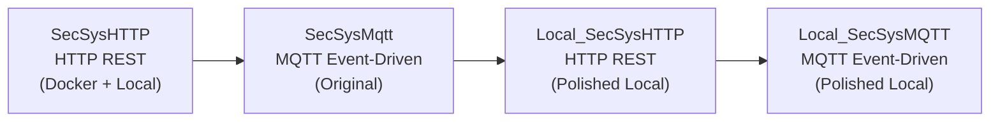

# Smart Security System — Project Versions Overview

This repository contains **4 versions** of a biometric smart door security system. Each version is a progression of the same application concept, demonstrating different architectural patterns from basic REST to IoT-style MQTT messaging.

---

## 📁 Project Structure

```
PrevProjects/
├── Local_SecSys/
│   ├── Local_SecSysHTTP/     ← Version 3: Polished local HTTP REST edition
│   └── Local_SecSysMQTT/     ← Version 4: Polished local MQTT event-driven edition
├── SecSysHTTP/               ← Version 1: HTTP REST (with Docker Compose support)
└── SecSysMqtt/               ← Version 2: MQTT event-driven (original)
```

---

## 🔄 Version Progression



| Version | Folder | Transport | Docker | Start Script | Notes |
| :--- | :--- | :--- | :--- | :--- | :--- |
| **v1** | `SecSysHTTP/` | HTTP REST | ✅ | `start_local.ps1` | Original HTTP version |
| **v2** | `SecSysMqtt/` | MQTT | ❌ | `start_local.ps1` | Original MQTT version |
| **v3** | `Local_SecSys/Local_SecSysHTTP/` | HTTP REST | ❌ | `start_local.ps1` | Polished HTTP version |
| **v4** | `Local_SecSys/Local_SecSysMQTT/` | MQTT | ❌ | `start_local.ps1` | Polished MQTT version |

---

## ⚙️ Common Prerequisites (All Versions)

1. **Python 3.9** — required for DeepFace compatibility:
   ```powershell
   py -3.9 --version   # Should print Python 3.9.x
   ```
2. **MongoDB Community Server** — running on port `27017`:
   ```powershell
   Get-Service MongoDB   # Should show: Running
   ```
3. **Eclipse Mosquitto** — only needed for MQTT versions (`SecSysMqtt`, `Local_SecSysMQTT`):
   ```powershell
   winget install EclipseFoundation.Mosquitto
   ```

---

## 🚀 Quick Start (Any Version)

Each project folder is self-contained. To run any version:

```powershell
# 1. Navigate to the project folder
cd SecSysHTTP          # or SecSysMqtt, Local_SecSys\Local_SecSysHTTP, etc.

# 2. Create and activate virtual environment (first time only)
py -3.9 -m venv .venv
.\.venv\Scripts\Activate.ps1
pip install -r requirements.txt

# 3. Launch all services with one command
.\start_local.ps1

# 4. To stop all services
.\stop_local.ps1
```

Then open **http://localhost:8000** in your browser.

---

## 🧪 Demo Credentials (All Versions)

| Field | Value |
| :--- | :--- |
| **Door Name** | `Door1` |
| **Username** | `manish` |
| **PIN** | `1234` |
| **Test Face Image** | `Backend/faces/bob1.jpeg` |

---

## ⏱️ Face Verification Note

> [!IMPORTANT]
> Face verification is **intentionally slow on first run** (30–90 seconds). This is because TensorFlow initializes and DeepFace downloads ~200 MB of pretrained Facenet/RetinaFace model weights. Subsequent verifications take 3–7 seconds.

---

## 📖 Individual READMEs

Each project has its own detailed README:

- [`SecSysHTTP/README.md`](SecSysHTTP/README.md)
- [`SecSysMqtt/README.md`](SecSysMqtt/README.md)
- [`Local_SecSys/Local_SecSysHTTP/README.md`](Local_SecSys/Local_SecSysHTTP/README.md)
- [`Local_SecSys/Local_SecSysMQTT/README.md`](Local_SecSys/Local_SecSysMQTT/README.md)
