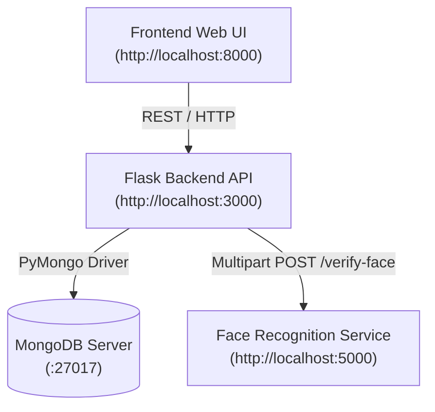

# Smart Security System — HTTP REST Edition

A microservices-based smart door security system with biometric facial recognition and PIN verification, built using **Python (Flask)**, **DeepFace (Facenet + RetinaFace)**, **MongoDB**, and a **Vanilla HTML/JavaScript** frontend.

> [!NOTE]
> This is the original version of the application (pre-Local). It supports both **Docker Compose** and **local manual** startup. For Docker, see [Option A](#option-a--docker-compose). For local without Docker, see [Option B](#option-b--local-startup).

---

## 🏛 Architecture



| Service | Port | Description |
| :--- | :--- | :--- |
| **Frontend** | `8000` | Browser-based user interface for door selection, face capture, and PIN entry. |
| **Backend API** | `3000` | Central REST gateway managing business logic, door lookup, and database records. |
| **Face Recognition** | `5000` | Biometric microservice using DeepFace with the Facenet model & RetinaFace detector. |
| **MongoDB** | `27017` | NoSQL database storing registered doors, hashed user PINs, and enrolled face vectors. |

---

## ⏱️ Important Note: Face Verification Latency

> [!IMPORTANT]
> **"Verify Face" takes time — this is normal and expected!**
>
> - **Why it takes time**: The service runs a deep neural network pipeline:
>   1. **RetinaFace detector**: Scans both the uploaded image and stored database images to locate and align faces.
>   2. **Facenet model**: Computes high-dimensional facial embeddings and calculates cosine similarity.
> - **First Run**: Can take **30 to 90 seconds** because TensorFlow initializes its computation graph and DeepFace automatically downloads pretrained model weights (~200 MB).
> - **Subsequent Runs**: Usually take **3 to 6 seconds** per verification.

---

## ⚙️ Prerequisites

1. **Python 3.9** installed (recommended for DeepFace compatibility).
2. **MongoDB Community Server** running locally on port `27017`.
3. **Git** (optional, for cloning).

---

## 📦 Installation

### Create virtual environment and install dependencies:

```powershell
python -m venv .venv
.\.venv\Scripts\Activate.ps1
pip install -r requirements.txt
```

---

## 🚀 How to Run

### Option A — Docker Compose

Requires Docker Desktop. From this directory:

```powershell
docker compose up --build -d
```

Seed demo data:

```powershell
docker compose exec backend python seed_data.py
```

Serve the frontend (in a separate terminal):

```powershell
python -m http.server 8000 --directory Frontend
```

Open `http://localhost:8000`. To stop:

```powershell
docker compose down
```

---

### Option B — Local Startup

#### Method 1: One-Click Startup (Recommended)

Run the included PowerShell script from this folder:

```powershell
.\start_local.ps1
```

**What this script does automatically:**
1. Detects your active MongoDB port (`27017` or `23017`).
2. Seeds the database with demo door, user, and face profiles.
3. Spawns 3 separate labeled PowerShell windows:
   - Window 1: **Face Recognition Service** (`:5000`)
   - Window 2: **Backend API** (`:3000`)
   - Window 3: **Frontend Web Server** (`:8000`)
4. Launches your default browser to `http://localhost:8000`.

To stop all services:
```powershell
.\stop_local.ps1
```

#### Method 2: Manual Step-by-Step

**Terminal 1 — Face Recognition Service:**
```powershell
cd Face_rec
python app.py
```
*Listens on `http://localhost:5000`.*

**Terminal 2 — Backend API:**
```powershell
cd Backend
python seed_data.py    # Run once to insert demo data
python app.py
```
*Listens on `http://localhost:3000`.*

**Terminal 3 — Frontend:**
```powershell
python -m http.server 8000 --directory Frontend
```
*Open `http://localhost:8000`.*

---

## 🧪 Demo Testing Walkthrough

1. **Step 1 — Door Selection**: Enter `Door1` → Click **Continue**.
2. **Step 2 — Face Upload**: Click **Choose File** → select `Backend\faces\bob1.jpeg` → Click **Upload Face**.
3. **Step 3 — Verify Face**: Click **Verify Face** → wait for DeepFace inference → *Face verified. User identified: `manish`*.
4. **Step 4 — Verify PIN**: Enter `1234` → Click **Verify PIN** → *Access Granted ✅*.

---

## 📡 REST API Reference

| Endpoint | Method | Payload | Description |
| :--- | :--- | :--- | :--- |
| `/health` | `GET` | None | Backend & MongoDB health check |
| `/ring-doorbell` | `POST` | `{"doorName": "Door1"}` | Validates door existence |
| `/face-upload` | `POST` | Multipart field `face` | Stores uploaded image; returns `face_id` |
| `/verifyFace` | `POST` | `{"doorName": "Door1", "face_id": "..."}` | Compares uploaded face against stored faces |
| `/verifyPin` | `POST` | `{"doorName": "Door1", "username": "manish", "plainPin": "1234"}` | Validates bcrypt PIN hash |

---

## 🛠️ Troubleshooting

- **"Face recognition service unavailable"**: Ensure `Face_rec/app.py` is running on port 5000. Check `http://localhost:5000/health`.
- **"Database unavailable"**: Make sure MongoDB is running (`Get-Service MongoDB`).
- **Port already in use**: Run `.\stop_local.ps1` to clear any hung processes.
- **First-time model download**: DeepFace downloads ~200 MB of model weights on first use. Ensure you have internet access.

> [!NOTE]
> This is a student/demo implementation. Do not connect it to a real lock without adding authentication, rate limiting, TLS, and a full security review.
