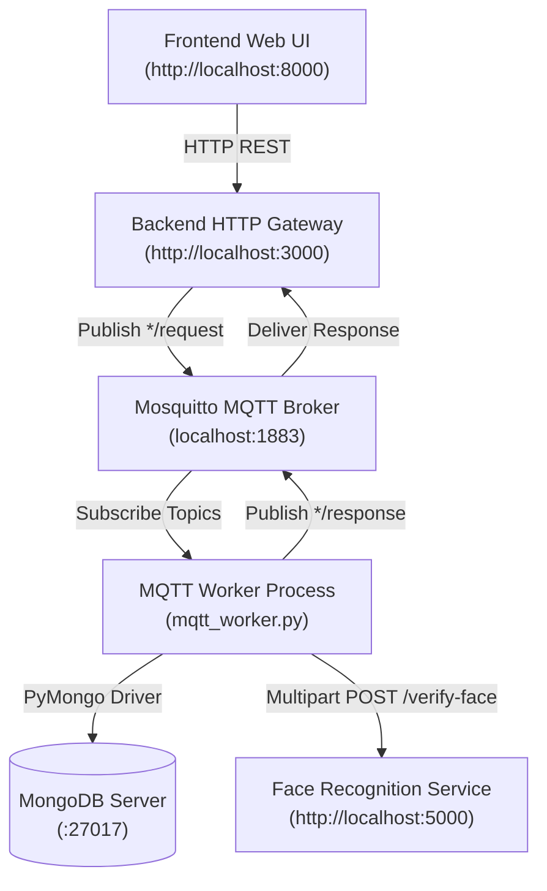

# Smart Security System — MQTT Event-Driven Edition

An asynchronous, IoT-inspired smart door security system with biometric facial recognition and PIN verification, built using **Python (Flask & Paho-MQTT)**, **Eclipse Mosquitto MQTT Broker**, **DeepFace (Facenet + RetinaFace)**, **MongoDB**, and a **Vanilla HTML/JavaScript** frontend.

> [!NOTE]
> This is the original MQTT version of the application (pre-Local). It uses an asynchronous MQTT message bus architecture rather than direct HTTP calls between services.

---

## 🏛 Architecture



| Service | Port / Protocol | Description |
| :--- | :--- | :--- |
| **Frontend** | `8000` (HTTP) | Browser-based UI for door selection, face capture, and PIN entry. |
| **Backend Gateway** | `3000` (HTTP) | Converts browser HTTP requests into MQTT publish events and awaits broker responses. |
| **Mosquitto Broker** | `1883` (MQTT) | Message broker coordinating asynchronous request/response queues. |
| **MQTT Worker** | Native Process | Consumes request queues, executes database queries, and triggers biometric recognition. |
| **Face Recognition** | `5000` (HTTP) | Biometric microservice running DeepFace with Facenet & RetinaFace. |
| **MongoDB** | `27017` | Stores doors, users, hashed PINs, and enrolled face vectors. |

---

## ⏱️ Important Note: Face Verification Latency

> [!IMPORTANT]
> **"Verify Face" takes time — this is normal and expected!**
>
> In the MQTT edition, face verification takes longer than a direct HTTP call due to the multi-hop async architecture:
> 1. **Message Broker Transit**: Request is published to `face/verify/request` MQTT topic.
> 2. **Worker Pickup**: `mqtt_worker.py` receives the message and looks up the door in MongoDB.
> 3. **DeepFace Pipeline**: Image processed through RetinaFace + Facenet for cosine similarity comparison.
> 4. **Response Publishing**: Result published back to `face/verify/response` and picked up by the gateway.
>
> - **First Run**: Can take **30 to 90 seconds** while TensorFlow initializes and downloads model weights (~200 MB).
> - **Subsequent Runs**: Usually take **3 to 7 seconds** per verification.

---

## ⚙️ Prerequisites

1. **Python 3.9** installed (recommended for DeepFace compatibility).
2. **MongoDB Community Server** running locally on port `27017`.
3. **Eclipse Mosquitto MQTT Broker**:
   ```powershell
   winget install EclipseFoundation.Mosquitto
   ```
   *(Mosquitto automatically registers and starts as a Windows service on port 1883.)*

---

## 📦 Installation

### Create virtual environment and install dependencies:

```powershell
python -m venv .venv
.\.venv\Scripts\Activate.ps1
pip install -r requirements.txt
```

---

## 🚀 How to Run

### Method 1: One-Click Startup (Recommended)

Run the included PowerShell script from this folder:

```powershell
.\start_local.ps1
```

**What this script does automatically:**
1. Verifies MongoDB (`:27017`) and Mosquitto (`:1883`) are active.
2. Seeds the database with demo door, user, and face profiles.
3. Spawns 4 separate labeled PowerShell windows:
   - Window 1: **Face Recognition Service** (`:5000`)
   - Window 2: **MQTT Worker Daemon**
   - Window 3: **Backend HTTP Gateway** (`:3000`)
   - Window 4: **Frontend Web Server** (`:8000`)
4. Launches your default browser to `http://localhost:8000`.

To stop all services:
```powershell
.\stop_local.ps1
```

### Method 2: Manual Step-by-Step

#### 1. Ensure Mosquitto is running
```powershell
Get-Service mosquitto
# If stopped: Start-Service mosquitto
# Mosquitto Docker Image recommended if using Windows.
```

#### 2. Start Face Recognition Service (Terminal 1)
```powershell
cd Face_rec
python app.py
```

#### 3. Start MQTT Worker (Terminal 2)
```powershell
cd Backend
python mqtt_worker.py
```
*Expected: `MQTT Worker connected`*

#### 4. Start Backend HTTP Gateway (Terminal 3)
```powershell
cd Backend
python seed_data.py   # Run once
python app.py
```

#### 5. Start Frontend (Terminal 4)
```powershell
python -m http.server 8000 --directory Frontend
```
*Open `http://localhost:8000`.*

---

## 🧪 Demo Testing Walkthrough

1. **Step 1 — Door Selection**: Enter `Door1` → Click **Continue**.
2. **Step 2 — Face Upload**: Click **Choose File** → select `Backend\faces\bob1.jpeg` → Click **Upload Face**.
3. **Step 3 — Verify Face**: Click **Verify Face** → wait for MQTT routing + DeepFace inference → *Face verified. User identified: `manish`*.
4. **Step 4 — Verify PIN**: Enter `1234` → Click **Verify PIN** → *Access Granted ✅*.

---

## 📬 MQTT Topics

| Request Topic | Response Topic | Description |
| :--- | :--- | :--- |
| `door/ring/request` | `door/ring/response` | Queries door collection for door ID |
| `face/upload/request` | `face/upload/response` | Saves image into `faces` collection |
| `face/verify/request` | `face/verify/response` | Triggers DeepFace comparison |
| `pin/verify/request` | `pin/verify/response` | Checks salted bcrypt PIN hash |

---

## 📡 REST API Reference (Backend Gateway)

| Endpoint | Method | Payload | Description |
| :--- | :--- | :--- | :--- |
| `/ring-doorbell` | `POST` | `{"doorName": "Door1"}` | Validates door existence |
| `/face-upload` | `POST` | Multipart field `face` | Stores uploaded image; returns `face_id` |
| `/verifyFace` | `POST` | `{"doorName": "Door1", "face_id": "..."}` | Triggers face verification via MQTT |
| `/verifyPin` | `POST` | `{"doorName": "Door1", "username": "manish", "plainPin": "1234"}` | Validates PIN via MQTT |

---

## 🛠️ Troubleshooting

- **"Mosquitto is not running on port 1883"**: Install via `winget install EclipseFoundation.Mosquitto`, then `Start-Service mosquitto`.
- **"Face recognition service unavailable"**: Ensure `Face_rec/app.py` is running on port 5000. Test `http://localhost:5000/health`.
- **Worker not responding**: Check the MQTT Worker terminal — it should print `MQTT Worker connected`.
- **Port already in use**: Run `.\stop_local.ps1`.

> [!NOTE]
> This is a student/demo implementation. Do not connect it to a real lock without adding authentication, rate limiting, TLS, and a full security review.